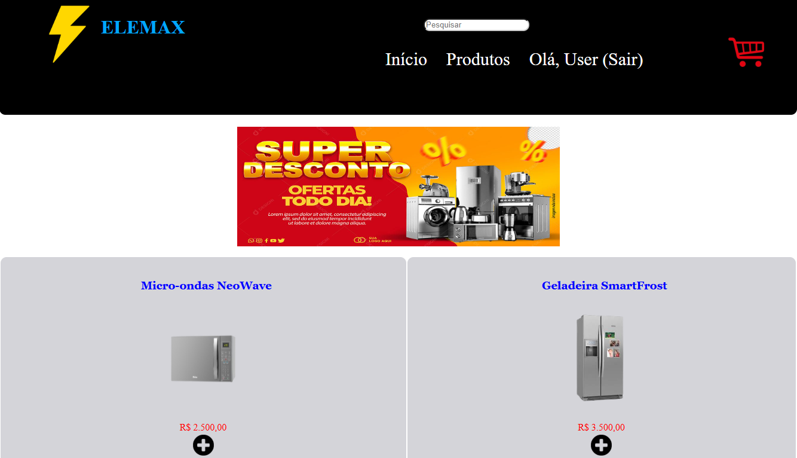

# 🛒 Elemax - Sistema E-commerce de Eletrodomésticos

Projeto desenvolvido como requisito avaliativo de uma matéria do 4º semestre do curso técnico em informática. Trata-se de uma aplicação web voltada para o comércio eletrônico de eletrodomésticos, contemplando fluxo completo de cadastro de usuários, gestão de produtos, carrinho de compras e controle de pedidos.

---

## 📸 Demonstração do Sistema

| Tela Inicial | Tela da venda finalizada |
| :---: | :---: |
|  |  |

---

## 🚀 Tecnologias Utilizadas

- **PHP:** Lógica de backend e manipulação de sessões/dados.
- **JavaScript:** Interatividade no lado do cliente e validações.
- **MySQL:** Banco de dados relacional para persistência de dados (usuários, produtos e pedidos).
- **HTML5 & CSS3:** Estruturação e estilização das interfaces.

---

## ✨ Funcionalidades

- **Autenticação:** Sistema de cadastro e login de usuários (`cadastro.php`, `login.php`).
- **Catálogo e Promoções:** Visualização de produtos em destaque e páginas específicas de ofertas (`inicio.php`,  `menu.php`).
- **Carrinho de Compras:** Adição de itens, controle de fluxo e finalização de pedidos (`carrinho.php`, `finalizar.php`, `pedidos.php`).
- **Conexão com Banco de Dados:** Módulo centralizado para comunicação segura com o MySQL (`conexao.exemplo.php`).

---

## 📁 Estrutura do Repositório

```text
├── database/              # Scripts e estrutura do banco de dados MySQL
├── imagem/ & img/         # Ativos visuais e imagens dos eletrodomésticos
├── cadastro.php           # Tela de registro de novos usuários
├── carrinho.php           # Gestão do carrinho de compras
├── conexao.exemplo.php    # Conexão MySQLi com o banco
├── css.css                # Estilos globais da aplicação
├── finalizar.php          # Lógica de fechamento de pedido
├── inicio.php             # Página inicial (Home) do sistema
├── js.js                  # Scripts e manipulação do DOM em JavaScript
├── login.php              # Tela de autenticação
├── menu.php               # Exibe promoções
├── pedidos.php            # Histórico/visualização de pedidos
├── produto.php            # Cadastra promoções
├── promocao.php           # Página de ofertas
└── sobre.html             # Página institucional sobre a loja
```

---

## 🛠️ Acessar o Projeto Online

http://elemax.page.gd/inicio.php
