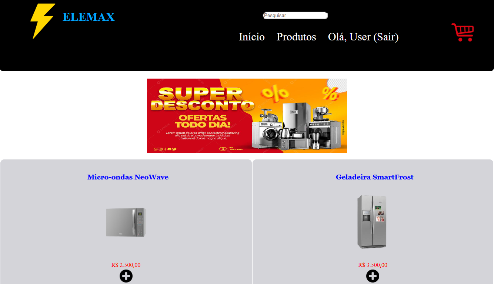
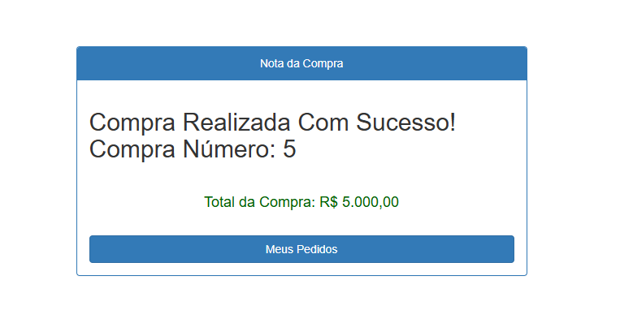

# 🛒 Elemax - Sistema E-commerce de Eletrodomésticos

Projeto desenvolvido como requisito avaliativo de uma matéria do 4º semestre do curso técnico em informática. Trata-se de uma aplicação web voltada para o comércio eletrônico de eletrodomésticos, contemplando fluxo completo de cadastro de usuários, gestão de produtos, carrinho de compras e controle de pedidos.

---

## 📸 Demonstração do Sistema

| Tela Inicial / Catálogo | Tela da venda finalizada |
| :---: | :---: |
|  |  |

---

## 🚀 Tecnologias Utilizadas

- **PHP:** Lógica de backend e manipulação de sessões/dados.
- **JavaScript:** Interatividade no lado do cliente e validações.
- **MySQL:** Banco de dados relacional para persistência de dados (usuários, produtos e pedidos).
- **HTML5 & CSS3:** Estruturação e estilização das interfaces.

---

## ✨ Funcionalidades

- **Autenticação:** Sistema de cadastro e login de usuários (`cadastro.php`, `login.php`).
- **Catálogo e Promoções:** Visualização de produtos em destaque e páginas específicas de ofertas (`promocao.php`).
- **Carrinho de Compras:** Adição de itens, controle de fluxo e finalização de pedidos (`carrinho.php`, `finalizar.php`, `pedidos.php`).
- **Conexão com Banco de Dados:** Módulo centralizado para comunicação segura com o MySQL (`conexao.php`).

---

## 📁 Estrutura do Repositório

```text
├── database/         # Scripts e estrutura do banco de dados MySQL
├── imagem/ & img/    # Ativos visuais e imagens dos eletrodomésticos
├── cadastro.php      # Tela de registro de novos usuários
├── carrinho.php      # Gestão do carrinho de compras
├── conexao.php       # Conexão PDO/MySQLi com o banco
├── css.css           # Estilos globais da aplicação
├── finalizar.php     # Lógica de fechamento de pedido
├── inicio.php        # Página inicial (Home) do sistema
├── js.js             # Scripts e manipulação do DOM em JavaScript
├── login.php         # Tela de autenticação
├── menu.php          # Componente de navegação reutilizável
├── pedidos.php       # Histórico/visualização de pedidos
├── produto.php       # Detalhes e exibição do produto
├── promocao.php      # Página de ofertas
└── sobre.html        # Página institucional sobre a loja


🔧 Como Executar o Projeto Localmente

1 - Clonar o repositório:

git clone [https://github.com/SEU-USUARIO/elemax.git](https://github.com/SEU-USUARIO/elemax.git)

2 - Configurar o ambiente servidor:

Mova a pasta do projeto para o diretório htdocs (no caso do XAMPP) ou www (no WampServer).

Inicie os serviços de Apache e MySQL.

3 - Importar o Banco de Dados:

Acesse o phpMyAdmin (http://localhost/phpmyadmin).

Crie um banco de dados MySQL e importe o script .sql localizado na pasta /database.

4 - Acessar a aplicação:

Abra o navegador e acesse: http://localhost/elemax/inicio.php
